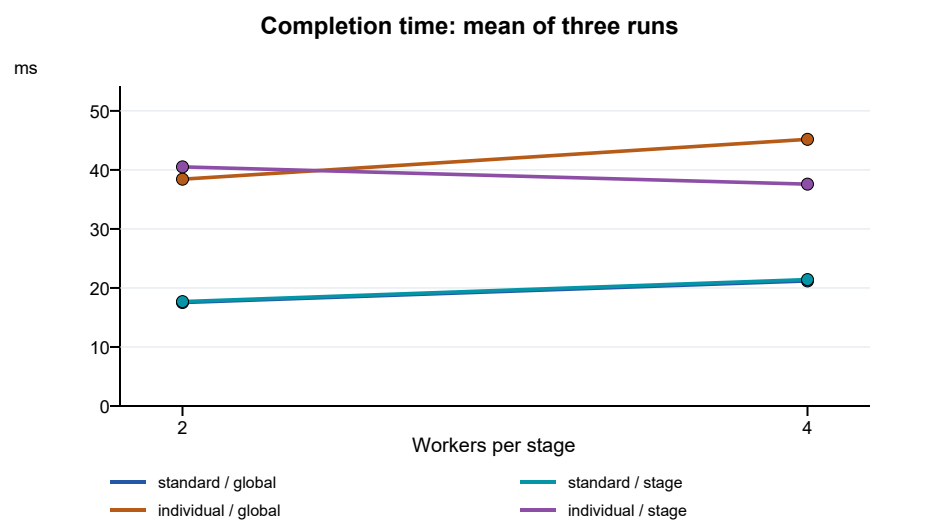
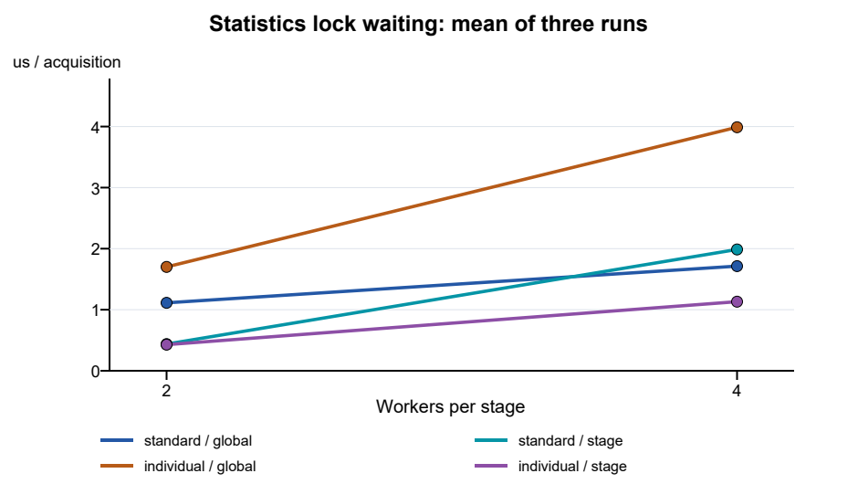
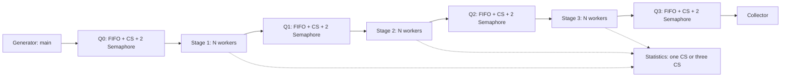

# Лабораторная работа №4
# Взаимное исключение и синхронизация

Дисциплина: ОСИСП  
Вариант 22: Синхронизация статистики  
STUDENT_ID: 109  
Учебное заведение: ____________________  
Выполнил: ____________________  
Группа: ____________________  
Проверил: ____________________  
Год: 2026

## Оглавление

1. Введение, цель и индивидуальное задание
2. Теоретические сведения
3. Архитектура, потоки и ресурсы
4. Алгоритм и синхронизация
5. Windows API и обработка ошибок
6. Инварианты и проверка корректности
7. Методика экспериментов
8. Результаты и графики
9. Анализ и заключение
10. Источники
Приложение Б. Репозиторий Git
Приложение В. Исходники графиков и схем
Приложение Г. Полный исходный код

## 1. Введение, цель и индивидуальное задание

Конкурентное обновление общей статистики требует взаимного исключения. Цель работы -
изучить Critical Section и Semaphore Windows и измерить влияние гранулярности блокировок.
Для варианта 22 реализована трёхступенчатая система со сбором статистики. Сравниваются
одна общая критическая секция статистики и отдельная секция каждой ступени. Исследуются
2 и 4 рабочих потока на каждой ступени. Измеряется ожидание доступа к статистике.

Стандартная нагрузка: BASE_OPERATIONS=500 заявок, SEED=1000. Индивидуальная:
OPERATIONS=500+109*5=1045 заявок; SEED=1000+109*97=11573. Operations означает число
созданных заявок; каждая проходит три обработки. Начальные данные определяются seed
и номером заявки, поэтому вход воспроизводим без зависимости от порядка потоков.

## 2. Теоретические сведения

Состояние гонки возникает при несогласованном обращении к общим данным. Критическая
секция допускает одного владельца и предназначена для потоков одного процесса.
Порядок получения секции не гарантирует FIFO. Семафор хранит число доступных единиц
ресурса. В ограниченной очереди один семафор считает элементы, другой - свободные места.
Чтение и изменение самой очереди дополнительно защищаются критической секцией.

Крупная блокировка упрощает защиту общей структуры, но связывает независимые изменения.
При разделении статистики по ступеням разные ступени могут обновлять разные счётчики
одновременно. Дополнительные блокировки и планирование потоков также имеют стоимость.
Увеличение параллелизма само по себе не гарантирует ускорения.

## 3. Архитектура, потоки и ресурсы

Один процесс содержит Generator в основном потоке, 3*N рабочих потоков и Collector.
При N=2 это 8 потоков всего, при N=4 - 14. Каждый участник получает уникальный номер:
Generator=0, рабочие=1..3N, Collector=3N+1. Журнал содержит PID и TID.
Между соседними участниками находятся четыре ограниченные FIFO-очереди.

```text
Generator -> Q0 -> Stage1[N] -> Q1 -> Stage2[N] -> Q2 -> Stage3[N] -> Q3 -> Collector
```

В каждой очереди: deque<Job>, Critical Section, Semaphore items, Semaphore spaces.
Ёмкость по умолчанию 32. Очереди не зависят от выбранного режима статистики.
Общие данные: очереди, три StageStats, состояния заявок, результаты, Event отмены.
Local каждого рабочего хранит собственные метрики и не требует блокировки. Collector
единолично записывает результаты; основной поток читает их только после join.

Структура Job содержит id, value, временные метки и накопленное ожидание. Отрицательный
id обозначает служебный элемент остановки. Каждая ступень преобразует value ограниченным
целочисленным вычислением. В StageStats хранятся count и checksum. Итоговая статистика
читается основным потоком после завершения всех рабочих, поэтому снимок согласован.

## 4. Алгоритм и синхронизация

Producer ожидает spaces, добавляет элемент под CS очереди и увеличивает items.
Consumer ожидает items, извлекает элемент под CS и увеличивает spaces. Ожидание
семафоров выполняется вне CS, поэтому поток не удерживает очередь, ожидая партнёра.
Очередь FIFO определяет порядок извлечения; завершения нескольких рабочих могут
происходить в другом порядке, результаты связываются по id.

После вычисления рабочий выбирает globalStats либо stageLocks[stage], измеряет время
до и после EnterCriticalSection, обновляет count и checksum, затем освобождает секцию.
В обоих режимах выполняется одинаковая работа. Параметр stats-work=2000 задаёт число
шагов синтетического обновления контрольной суммы внутри секции. Это управляемая
нагрузка на статистику, а не обязательная стоимость обычного инкремента. Параметр
work=20000 задаёт шаги обработки заявки вне секции. Sleep для согласования не применяется.

Основные фрагменты реализации:

```cpp
auto t = counter();
c.wait(spaces.h);
{ Guard guard(lock); jobs.push_back(job); }
release(items.h);
```

```cpp
CS& lock = c.cfg.separate ? c.stageLocks[l.stage] : c.globalStats;
auto before = counter();
{
    Guard guard(lock);
    auto acquired = counter();
    l.statsWait += c.ms(acquired-before);
    auto& stat = c.stats[l.stage];
    ++stat.count;
    // bounded checksum update
}
```

Штатное завершение: Generator помещает N STOP в Q0 и ожидает первую группу. Затем
помещает N STOP в Q1 и ожидает вторую, аналогично третью. После третьей ступени
в Q3 помещается один STOP для Collector. STOP добавляется только после завершения
предыдущей группы, поэтому в очереди не появятся новые данные после служебных элементов.

Вложенного удержания секций очереди и статистики нет. После отмены все ожидания
семафоров просыпаются по manual-reset Event. Все потоки присоединяются перед удалением
общих объектов, в том числе если создание части рабочих не удалось.

## 5. Windows API и обработка ошибок

| API | Назначение |
|---|---|
| CreateThread | Запуск рабочих и сборщика |
| InitializeCriticalSectionEx | Инициализация CS |
| EnterCriticalSection / LeaveCriticalSection | Взаимное исключение |
| DeleteCriticalSection | Освобождение CS |
| CreateSemaphoreW / ReleaseSemaphore | Учёт элементов и мест |
| CreateEventW / SetEvent | Общая отмена |
| WaitForMultipleObjects | Ожидание ресурса или отмены с дедлайном |
| WaitForSingleObject | Присоединение завершающихся потоков |
| InterlockedCompareExchange | Атомарный контроль состояния заявки |
| QueryPerformanceCounter / Frequency | Измерение времени |
| GetCurrentProcessId / GetCurrentThreadId | Идентификация участников |
| GetLastError / FormatMessageA / LocalFree | Диагностика |
| CloseHandle | Закрытие HANDLE |

Проверяются результаты вызовов, возвращающих статус. При системной ошибке выводится
диагностика; ввод проверяется до создания участников. Все HANDLE и CS освобождаются
объектами RAII. Исключение рабочего устанавливает отмену и приводит к коду 1.
TerminateThread не применяется. Указанное max-ms ограничивает моделирование; при
отмене допускается короткое превышение на завершение текущей ограниченной операции
и join. Дедлайн не включает последующую последовательную проверку результатов.
EnterCriticalSection не имеет тайм-аута: код секций конечен, не ожидает других ресурсов,
а параметры ограничены. Это предотвращает алгоритмическое зависание в модели;
пауза самого процесса средствами ОС не может быть ограничена таким дедлайном.

## 6. Инварианты и проверка корректности

Проверяются отсутствие переполнения/опустошения очереди, допустимость id и однократность
каждой обработки. Состояния заявки: 0 -> 1 -> 2 -> 3 -> 4 -> 5 -> 6 -> 7, где нечётные
1,3,5 означают обработку на соответствующей ступени, 2,4,6 - завершение ступени,
7 - получение Collector. Переходы выполняются InterlockedCompareExchange с проверкой
предыдущего состояния. Дубликат либо нарушение порядка вызывает ошибку.

После join проверяются: completed=operations, все состояния равны 7, пустые очереди,
count каждой ступени равен operations, все результаты и суммы checksum совпадают
с независимым последовательным повтором того же вычисления. Число нарушений,
ошибок и тайм-аутов выводится в SUMMARY. Успешные тесты дополняют обоснование
синхронизации, но не доказывают отсутствие любой возможной ошибки.

Девять тестов tests/test.ps1: режимы global/stage при capacity=1, одна заявка при
четырёх рабочих, индивидуальная нагрузка, управляемый отказ рабочего на id=10,
дедлайн 10 мс при тяжёлой нагрузке, нулевое число рабочих, неверный режим,
неизвестный параметр. Все тесты прошли. В тесте дедлайна зафиксирована отмена без
потери управления; в тесте отказа остальные потоки завершились через Event.
Журналы: data/tests/*.txt, итог: data/tests/results.csv. Подробный демонстрационный
журнал 12 заявок - data/demo.txt; он содержит WAITING_QUEUE, WORKING, WAITING_STATS,
RELEASED_STATS, COLLECTED, FINISHED и идентификаторы заявок.

## 7. Методика экспериментов

Эксперименты выполнены 10.11.2026: Windows 10.0.19045 x64, Intel64 Family 6 Model 42,
MinGW GCC 15.2.0, C++17, оптимизация O2. Для каждой комбинации нагрузки, режима
и числа рабочих выполнены три отдельных запуска: всего 24. Подробный журнал отключён.
Порядок global/stage меняется во втором повторе. Очереди capacity=32, work=20000,
stats-work=2000, max-ms=30000. Все параметры доступны в CLI.

elapsed_ms включает создание потоков, обработку и штатный join; создание очередей и
последовательная проверка после join исключены. Пропускная способность - завершённые
заявки в секунду. mean_stats_wait_us - сумма ожиданий секции статистики, делённая на
3*operations, в микросекундах. Измерение охватывает накладные расходы входа в секцию
и планирования. Время печати подробных событий отсутствует, накладные расходы вызовов
журнала и измерений остаются одинаковыми в двух режимах.

mean_request_ms - средняя длительность от первой попытки постановки до Collector;
mean_request_wait_ms - суммарное ожидание свободного места и пребывание в очередях
на одну заявку. queue_wait_ms отдельно суммирует блокирующие ожидания рабочих
на семафорах; эти показатели имеют разный смысл. processing_ms измеряет вычисление
вне статистики. utilization - доля времени занятости рабочих от извлечения до
завершения обновления статистики, включая ожидание её CS; это не загрузка CPU.
Суммы времён разных потоков могут превышать elapsed_ms.

## 8. Результаты и графики

В обозначениях ниже standard=500 заявок, individual=1045, global=одна CS,
stage=три CS. Последнее число в конфигурации - число рабочих на ступень.

| Конфигурация | Запуск 1, мс | Запуск 2, мс | Запуск 3, мс | Среднее, мс |
| --- | --- | --- | --- | --- |
| individual / global / 2 | 35.650 | 42.417 | 37.216 | 38.428 |
| individual / global / 4 | 45.299 | 40.639 | 49.607 | 45.182 |
| individual / stage / 2 | 42.660 | 40.588 | 38.295 | 40.515 |
| individual / stage / 4 | 38.821 | 36.751 | 37.194 | 37.589 |
| standard / global / 2 | 17.868 | 17.581 | 17.142 | 17.530 |
| standard / global / 4 | 19.328 | 19.093 | 25.151 | 21.191 |
| standard / stage / 2 | 17.312 | 18.446 | 17.305 | 17.687 |
| standard / stage / 4 | 19.999 | 18.250 | 26.010 | 21.420 |

Профильные показатели (среднее трёх запусков):

| Конфигурация | Завершено | CS ожид., мкс | Заявка, мс | Заявок/с | Занятость, % |
| --- | --- | --- | --- | --- | --- |
| individual / global / 2 | 1045 | 1.701 | 2.822 | 27343 | 55.4 |
| individual / global / 4 | 1045 | 3.989 | 3.150 | 23283 | 24.6 |
| individual / stage / 2 | 1045 | 0.428 | 3.007 | 25843 | 51.0 |
| individual / stage / 4 | 1045 | 1.132 | 2.696 | 27816 | 26.3 |
| standard / global / 2 | 500 | 1.113 | 2.362 | 28530 | 53.9 |
| standard / global / 4 | 500 | 1.714 | 3.058 | 23979 | 22.7 |
| standard / stage / 2 | 500 | 0.437 | 2.309 | 28294 | 52.0 |
| standard / stage / 4 | 500 | 1.987 | 2.932 | 23874 | 23.5 |

Во всех 24 запусках rejected=0, violations=0, errors=0, timeouts=0.
Полные исходные данные со всеми метриками: data/experiments.csv и data/runs/*.txt.



График 1 - среднее время выполнения при изменении числа рабочих на ступень.
Линии соединяют только измеренные значения 2 и 4, интерполяция не исследована.



График 2 - среднее ожидание одного доступа к статистике. Исходники обоих графиков:
scripts/plot.py; редактируемые векторные версии: report/time.svg,
report/stats_wait.svg. Три повтора приведены в таблице и исходном CSV; графики
показывают только средние и не являются доверительными интервалами.

## 9. Анализ и заключение

standard, 2 потока на ступень: среднее ожидание global 1.113 мкс, stage 0.437 мкс; время 17.530 и 17.687 мс соответственно.

standard, 4 потока на ступень: среднее ожидание global 1.714 мкс, stage 1.987 мкс; время 21.191 и 21.420 мс соответственно.

individual, 2 потока на ступень: среднее ожидание global 1.701 мкс, stage 0.428 мкс; время 38.428 и 40.515 мс соответственно.

individual, 4 потока на ступень: среднее ожидание global 3.989 мкс, stage 1.132 мкс; время 45.182 и 37.589 мс соответственно.

Ожидалось снижение межступенчатой конкуренции при отдельных CS. Результат зависит
от числа потоков и нагрузки: на коротких запусках влияет планировщик, создание
потоков и загрузка компьютера. Поэтому отдельные CS не следует считать гарантией
ускорения каждого запуска. Четыре рабочих на ступень увеличивают конкуренцию внутри
ступени, а общий объём вычислений и накладные расходы ограничивают масштабирование.
Полученные средние характеризуют эти параметры и синтетическую стоимость статистики;
они не переносятся автоматически на реальное приложение с простым счётчиком.

Разработана трёхступенчатая модель Windows с двумя способами защиты статистики.
Семафоры обеспечивают ограничение очередей, критические секции защищают их содержимое
и статистику. Выполнены стандартные и индивидуальные эксперименты, построены два
графика по собственным данным. Все предусмотренные нормальные запуски завершились
без нарушений инвариантов; проверены отказ рабочего и ограничение времени.

## 10. Источники

1. Задание лабораторной работы, предоставленное пользователем, вариант 22.
2. Microsoft Learn. Critical Section Objects.
https://learn.microsoft.com/en-us/windows/win32/sync/critical-section-objects
3. Microsoft Learn. Semaphore Objects.
https://learn.microsoft.com/en-us/windows/win32/sync/semaphore-objects
4. Microsoft Learn. WaitForMultipleObjects.
https://learn.microsoft.com/en-us/windows/win32/api/synchapi/nf-synchapi-waitformultipleobjects
5. Microsoft Learn. Acquiring high-resolution time stamps.
https://learn.microsoft.com/en-us/windows/win32/sysinfo/acquiring-high-resolution-time-stamps

## Приложение Б. Репозиторий Git

Репозиторий: https://github.com/Bahemaal/OSISP
Ветка: main. Разработка велась с первого этапа в локальном Git. Адрес удалённого
репозитория предоставлен после первых этапов; первые три коммита опубликованы вместе.
Это не имитация разнесённых по времени отправок контрольных версий. Сроки преподавателя
и предоставление ему доступа студент согласует самостоятельно.

Контрольные коммиты:
e01da09 - проектирование структуры и архитектуры.
1ea0323 - реализация очередей, потоков и двух режимов статистики.
a6b84ef - инварианты, отмена, тесты и 24 измерения.

Окончательный технический комплект зафиксирован именованной версией lab04-v1.
Полный SHA указан в файле FINAL_COMMIT.txt рядом с отчётом после фиксации версии.
Сам отчёт не может содержать SHA коммита, который ещё включает его собственное
содержимое: после создания версии SHA записывается отдельным сопровождающим файлом.
Для представления со всеми личными приложениями следует создать следующую версию
и указать её фактический SHA в сопроводительных сведениях.

## Приложение В. Исходники графиков и схем

Построение графиков выполняется ReportLab LinePlot. PNG получены рендерингом
векторного рисунка через PDFium. Воспроизведение:

```text
python -m pip install reportlab pypdfium2
python scripts/plot.py
python scripts/build_report.py
```

Схема взаимодействия описана в Mermaid, файл diagrams/pipeline.mmd.



Полный листинг скрипта графиков приведён в PDF и находится в scripts/plot.py. Сборка отчёта: scripts/build_report.py.

## Приложение Г. Полный исходный код

```cpp
#define WIN32_LEAN_AND_MEAN
#define NOMINMAX
#include <windows.h>
#include <array>
#include <algorithm>
#include <atomic>
#include <cstdint>
#include <cstdio>
#include <deque>
#include <iostream>
#include <memory>
#include <stdexcept>
#include <string>
#include <vector>

[[noreturn]] void apiError(const char* api);
struct Handle {
    HANDLE h=nullptr;
    explicit Handle(HANDLE p=nullptr):h(p){}
    ~Handle(){if(h && h!=INVALID_HANDLE_VALUE) CloseHandle(h);}
    Handle(const Handle&)=delete; Handle& operator=(const Handle&)=delete;
};
struct CS {
    CRITICAL_SECTION cs;
    CS(){if(!InitializeCriticalSectionEx(&cs,0,0)) apiError("InitializeCriticalSectionEx");}
    ~CS(){DeleteCriticalSection(&cs);}
    CS(const CS&)=delete;
};
struct Guard {
    CS& c;
    explicit Guard(CS& s):c(s){EnterCriticalSection(&c.cs);}
    ~Guard(){LeaveCriticalSection(&c.cs);}
};
[[noreturn]] void apiError(const char* api){
    DWORD code=GetLastError(); char* text=nullptr;
    FormatMessageA(FORMAT_MESSAGE_ALLOCATE_BUFFER|FORMAT_MESSAGE_FROM_SYSTEM|FORMAT_MESSAGE_IGNORE_INSERTS,
        nullptr,code,0,reinterpret_cast<char*>(&text),0,nullptr);
    std::string message=std::string(api)+" GetLastError="+std::to_string(code)+" "+(text?text:"");
    if(text) LocalFree(text);
    throw std::runtime_error(message);
}
int64_t counter(){LARGE_INTEGER t;if(!QueryPerformanceCounter(&t))apiError("QueryPerformanceCounter");return t.QuadPart;}
struct Config {
    int workers=2,operations=500,capacity=32,work=20000,statsWork=2000,maxMs=30000;
    uint32_t seed=11573; bool separate=false,quiet=false; int inject=-1;
};
struct StageStats {uint64_t count=0,checksum=0;};
struct Local {
    int id=0,stage=0; uint64_t completed=0;
    double statsWait=0,statsHold=0,queueWait=0,busy=0,maxStatsWait=0,processing=0;
};
struct Job {int id=-1;uint64_t value=0;int64_t born=0,queued=0;double waitMs=0;};
struct Context;
struct Queue {
    CS lock; Handle items,spaces; std::deque<Job> jobs; size_t capacity,peak=0;
    Queue(int cap):items(CreateSemaphoreW(nullptr,0,cap,nullptr)),spaces(CreateSemaphoreW(nullptr,cap,cap,nullptr)),capacity(cap){
        if(!items.h || !spaces.h)apiError("CreateSemaphoreW");
    }
    void push(Context&,Job,double&);
    Job pop(Context&,double&);
};
struct Context {
    Config cfg; Handle cancel{CreateEventW(nullptr,TRUE,FALSE,nullptr)};
    CS logger,globalStats; std::array<CS,3> stageLocks;
    std::array<StageStats,3> stats{};
    std::array<std::unique_ptr<Queue>,4> queues;
    std::vector<LONG> states; std::vector<uint64_t> results;
    std::atomic<int> errors{0},violations{0},timeouts{0};
    int64_t begin=0; double frequency=0; std::string firstError;
    explicit Context(Config c):cfg(c),states(c.operations,0),results(c.operations,0){
        if(!cancel.h)apiError("CreateEventW");
        LARGE_INTEGER f;if(!QueryPerformanceFrequency(&f))apiError("QueryPerformanceFrequency");frequency=double(f.QuadPart);
        for(auto& q:queues)q=std::make_unique<Queue>(cfg.capacity);
        begin=counter();
    }
    double ms(int64_t ticks)const{return 1000.0*ticks/frequency;}
    void log(int id,const std::string& event,int job=-1,bool force=false){
        if(cfg.quiet && !force)return;
        Guard g(logger);
        std::cout<<"["<<ms(counter()-begin)<<" ms] PARTICIPANT="<<id<<" PID="<<GetCurrentProcessId()
                 <<" TID="<<GetCurrentThreadId()<<" "<<event;
        if(job>=0)std::cout<<" REQUEST="<<job;
        std::cout<<std::endl;
    }
    void fail(const std::string& message){
        ++errors;
        {Guard g(logger);if(firstError.empty())firstError=message;}
        if(!SetEvent(cancel.h))apiError("SetEvent");
    }
    DWORD remaining(){
        double left=cfg.maxMs-ms(counter()-begin);
        if(left<=0){++timeouts;throw std::runtime_error("EXPERIMENT_TIMEOUT");}
        return static_cast<DWORD>(std::max(1.0,left));
    }
    void wait(HANDLE h){
        HANDLE hs[]={cancel.h,h};DWORD w=WaitForMultipleObjects(2,hs,FALSE,remaining());
        if(w==WAIT_OBJECT_0+1)return;
        if(w==WAIT_TIMEOUT){++timeouts;throw std::runtime_error("EXPERIMENT_TIMEOUT");}
        if(w==WAIT_OBJECT_0)throw std::runtime_error("CANCELLED");
        apiError("WaitForMultipleObjects");
    }
    void invariant(bool ok,const char* message){if(!ok){++violations;throw std::runtime_error(message);}}
};
void release(HANDLE h){if(!ReleaseSemaphore(h,1,nullptr))apiError("ReleaseSemaphore");}
void Queue::push(Context& c,Job job,double& wait){
    auto t=counter();if(!job.born)job.born=t;
    c.wait(spaces.h);double blocked=c.ms(counter()-t);wait+=blocked;job.waitMs+=blocked;
    {Guard guard(lock);c.invariant(jobs.size()<capacity,"queue overflow");job.queued=counter();jobs.push_back(job);peak=std::max(peak,jobs.size());}
    release(items.h);
}
Job Queue::pop(Context& c,double& wait){
    auto t=counter();c.wait(items.h);wait+=c.ms(counter()-t);
    Job job;
    {Guard guard(lock);c.invariant(!jobs.empty(),"queue underflow");job=jobs.front();jobs.pop_front();job.waitMs+=c.ms(counter()-job.queued);}
    release(spaces.h);return job;
}
uint64_t process(uint64_t value,int stage,int iterations){
    value^=0x9e3779b97f4a7c15ull+static_cast<uint64_t>(stage);
    for(int i=0;i<iterations;++i)value=value*6364136223846793005ull+1442695040888963407ull;
    return value;
}
uint64_t initial(int id,uint32_t seed){return (uint64_t(seed)<<32)^uint64_t(id+1);}
struct Worker {Context* c;Local local;};
DWORD WINAPI workerMain(void* p){
    auto& w=*static_cast<Worker*>(p);auto& c=*w.c;auto& l=w.local;
    try{
        c.log(l.id,"START STAGE="+std::to_string(l.stage+1));
        for(;;){
            c.log(l.id,"WAITING_QUEUE");Job job=c.queues[l.stage]->pop(c,l.queueWait);
            if(job.id<0)break;
            auto busyBegin=counter();c.log(l.id,"WORKING",job.id);
            c.invariant(job.id<c.cfg.operations,"request id out of range");
            LONG expected=2*l.stage;
            c.invariant(InterlockedCompareExchange(&c.states[job.id],expected+1,expected)==expected,"duplicate/out-of-order stage start");
            if(c.cfg.inject==job.id && l.stage==1)throw std::runtime_error("INJECTED_WORKER_FAILURE");
            auto computeStart=counter();job.value=process(job.value,l.stage,c.cfg.work);
            l.processing+=c.ms(counter()-computeStart);
            CS& lock=c.cfg.separate?c.stageLocks[l.stage]:c.globalStats;
            c.log(l.id,"WAITING_STATS RESOURCE="+std::to_string(c.cfg.separate?l.stage:0),job.id);
            auto before=counter();
            {
                Guard guard(lock);auto acquired=counter();double waited=c.ms(acquired-before);
                l.statsWait+=waited;l.maxStatsWait=std::max(l.maxStatsWait,waited);
                auto& stat=c.stats[l.stage];++stat.count;
                // A bounded synthetic checksum update exposes contention. Identical in both modes.
                uint64_t audit=job.value;
                for(int i=0;i<c.cfg.statsWork;++i)audit=audit*2862933555777941757ull+3037000493ull;
                stat.checksum+=audit;
                l.statsHold+=c.ms(counter()-acquired);
            }
            c.log(l.id,"RELEASED_STATS",job.id);
            c.invariant(InterlockedCompareExchange(&c.states[job.id],expected+2,expected+1)==expected+1,"stage finish state");
            ++l.completed;l.busy+=c.ms(counter()-busyBegin);
            c.queues[l.stage+1]->push(c,job,l.queueWait);
        }
        c.log(l.id,"FINISHED");return 0;
    }catch(const std::exception& e){c.log(l.id,std::string("ERROR ")+e.what(),-1,true);c.fail(e.what());return 1;}
}
struct Collector {Context* c;uint64_t completed=0;double queueWait=0,latency=0,requestWait=0;};
DWORD WINAPI collectorMain(void* p){
    auto& x=*static_cast<Collector*>(p);auto& c=*x.c;int id=3*c.cfg.workers+1;
    try{
        c.log(id,"START COLLECTOR");
        for(;;){
            Job job=c.queues[3]->pop(c,x.queueWait);if(job.id<0)break;
            c.invariant(job.id<c.cfg.operations,"collector id out of range");
            c.invariant(InterlockedCompareExchange(&c.states[job.id],7,6)==6,"duplicate/incomplete result");
            c.results[job.id]=job.value;++x.completed;
            x.latency+=c.ms(counter()-job.born);x.requestWait+=job.waitMs;c.log(id,"COLLECTED",job.id);
        }
        c.log(id,"FINISHED");return 0;
    }catch(const std::exception& e){c.log(id,std::string("ERROR ")+e.what(),-1,true);c.fail(e.what());return 1;}
}
int integer(const std::string& s,int max){
    if(s.empty()||s.find_first_not_of("0123456789")!=std::string::npos)throw std::runtime_error("invalid integer");
    auto n=std::stoull(s);if(n>static_cast<unsigned>(max))throw std::runtime_error("integer out of range");return int(n);
}
int main(int argc,char** argv){
    try{
        Config cfg;
        for(int i=1;i<argc;++i){
            std::string a=argv[i];if(a=="--quiet"){cfg.quiet=true;continue;}
            if(a=="--help"){
                std::cout<<"Variant22: --mode global|stage --workers 1..16 --operations 1..100000\n"
                  "--individual (1045 operations) --capacity 1..4096 --seed N --work 0..1000000\n"
                  "--stats-work 0..1000000 --max-ms 1..600000 --inject-failure ID --quiet\n";return 0;
            }
            if(a=="--individual"){cfg.operations=1045;continue;}
            if(i+1==argc)throw std::runtime_error("missing option value");
            std::string v=argv[++i];
            if(a=="--mode"){if(v!="global"&&v!="stage")throw std::runtime_error("invalid mode");cfg.separate=v=="stage";}
            else if(a=="--workers")cfg.workers=integer(v,16);
            else if(a=="--operations")cfg.operations=integer(v,100000);
            else if(a=="--capacity")cfg.capacity=integer(v,4096);
            else if(a=="--seed")cfg.seed=integer(v,0x7fffffff);
            else if(a=="--work")cfg.work=integer(v,1000000);
            else if(a=="--stats-work")cfg.statsWork=integer(v,1000000);
            else if(a=="--max-ms")cfg.maxMs=integer(v,600000);
            else if(a=="--inject-failure")cfg.inject=integer(v,99999);
            else throw std::runtime_error("unknown option: "+a);
        }
        if(!cfg.workers||!cfg.operations||!cfg.capacity||!cfg.maxMs)throw std::runtime_error("positive parameters required");
        Context c(cfg);c.log(0,"START GENERATOR VARIANT=22 STUDENT_ID=109 SEED="+std::to_string(cfg.seed),-1,true);
        std::vector<Worker> workers(3*cfg.workers);std::vector<std::unique_ptr<Handle>> threads;
        Collector collector{&c};
        try{
            Handle* collectorThread=nullptr;
            threads.push_back(std::make_unique<Handle>(CreateThread(nullptr,0,collectorMain,&collector,0,nullptr)));
            if(!threads.back()->h)apiError("CreateThread collector");
            collectorThread=threads.back().get();
            for(int s=0;s<3;++s)for(int j=0;j<cfg.workers;++j){
                int index=s*cfg.workers+j;workers[index]={&c,{index+1,s}};
                threads.push_back(std::make_unique<Handle>(CreateThread(nullptr,0,workerMain,&workers[index],0,nullptr)));
                if(!threads.back()->h)apiError("CreateThread worker");
            }
            double generatorWait=0;
            for(int id=0;id<cfg.operations;++id){c.queues[0]->push(c,{id,initial(id,cfg.seed)},generatorWait);c.log(0,"CREATED",id);}
            c.log(0,"FINISHED_GENERATING");
            // Only the coordinator inserts stop tokens after the upstream group has joined.
            for(int s=0;s<3;++s){
                for(int j=0;j<cfg.workers;++j)c.queues[s]->push(c,{},generatorWait);
                for(int j=0;j<cfg.workers;++j)c.wait(threads[1+s*cfg.workers+j]->h);
            }
            c.queues[3]->push(c,{},generatorWait);c.wait(collectorThread->h);
        }catch(const std::exception& e){c.fail(e.what());}
        // After cancellation all semaphore waits wake; finite CPU operations release every CS.
        // Join before destroying queues, locks or thread arguments, including partial startup.
        for(auto& t:threads)if(t->h){if(WaitForSingleObject(t->h,INFINITE)==WAIT_FAILED)apiError("WaitForSingleObject join");}
        double elapsed=c.ms(counter()-c.begin);
        if(c.errors){std::cerr<<"FAILED errors="<<c.errors<<" violations="<<c.violations<<" timeouts="<<c.timeouts
            <<" reason="<<c.firstError<<std::endl;return 1;}
        // Sequential reference and final checks are outside the timed experiment.
        std::array<uint64_t,3> checksums{};
        c.invariant(collector.completed==static_cast<unsigned>(cfg.operations),"missing results");
        for(int i=0;i<cfg.operations;++i){
            c.invariant(c.states[i]==7,"unfinished request");uint64_t value=initial(i,cfg.seed);
            for(int s=0;s<3;++s){value=process(value,s,cfg.work);uint64_t audit=value;
                for(int n=0;n<cfg.statsWork;++n)audit=audit*2862933555777941757ull+3037000493ull;
                checksums[s]+=audit;}
            c.invariant(value==c.results[i],"sequential reference mismatch");
        }
        double wait=0,hold=0,busy=0,queueWait=0,maxWait=0,processing=0;
        for(const auto& w:workers){const auto& l=w.local;wait+=l.statsWait;hold+=l.statsHold;busy+=l.busy;queueWait+=l.queueWait;maxWait=std::max(maxWait,l.maxStatsWait);processing+=l.processing;
            std::cout<<"WORKER id="<<l.id<<" stage="<<l.stage+1<<" completed="<<l.completed
              <<" stats_wait_ms="<<l.statsWait<<" queue_wait_ms="<<l.queueWait<<" busy_ms="<<l.busy
              <<" processing_ms="<<l.processing<<std::endl;}
        for(int s=0;s<3;++s){
            c.invariant(c.stats[s].count==static_cast<unsigned>(cfg.operations),"statistics count mismatch");
            c.invariant(c.stats[s].checksum==checksums[s],"statistics checksum mismatch");
        }
        for(auto& q:c.queues)c.invariant(q->jobs.empty(),"queue not drained");
        std::cout<<"SUMMARY mode="<<(cfg.separate?"stage":"global")<<" workers="<<cfg.workers
          <<" operations="<<cfg.operations<<" completed="<<collector.completed<<" rejected=0 seed="<<cfg.seed
          <<" capacity="<<cfg.capacity<<" work="<<cfg.work<<" stats_work="<<cfg.statsWork
          <<" elapsed_ms="<<elapsed<<" throughput="<<1000.0*cfg.operations/elapsed
          <<" stats_wait_ms="<<wait<<" mean_stats_wait_us="<<wait*1000/(3*cfg.operations)
          <<" max_stats_wait_ms="<<maxWait<<" stats_hold_ms="<<hold<<" queue_wait_ms="<<queueWait
          <<" mean_request_ms="<<collector.latency/cfg.operations<<" mean_request_wait_ms="<<collector.requestWait/cfg.operations
          <<" processing_ms="<<processing
          <<" utilization="<<busy/(3*cfg.workers*elapsed)<<" violations="<<c.violations<<" timeouts="<<c.timeouts
          <<" errors="<<c.errors<<" peak0="<<c.queues[0]->peak<<" peak1="<<c.queues[1]->peak
          <<" peak2="<<c.queues[2]->peak<<" peak3="<<c.queues[3]->peak<<std::endl;
        return 0;
    }catch(const std::exception& e){std::cerr<<"ERROR "<<e.what()<<std::endl;return 1;}
}
```
